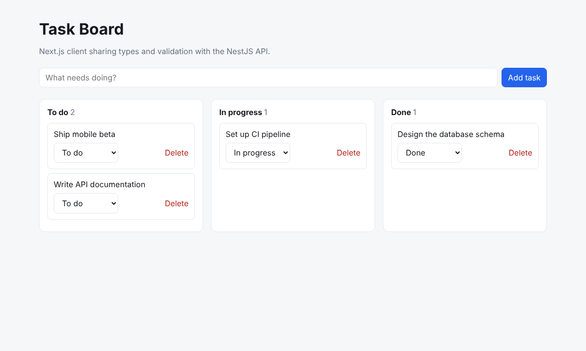

# Fullstack Monorepo Starter

[](https://github.com/cemxbt/fullstack-monorepo/actions/workflows/ci.yml)


A TypeScript monorepo with a **NestJS API**, a **Next.js web app** and an **Expo mobile app**
that share one contract package. Change a schema once and every app either keeps working or
fails to compile — there is no hand-written duplicate of the API types anywhere.



## What's inside

```
apps/
├── api/        NestJS 11 + Prisma 7 + PostgreSQL
├── web/        Next.js 15 (App Router)
└── mobile/     Expo SDK 53 / React Native
packages/
├── contracts/  Zod schemas, inferred types and a typed API client
└── tsconfig/   Shared TypeScript configuration
```

`@starter/contracts` is the centre of the repo:

- **Schemas** (`CreateTaskInput`, `UpdateTaskInput`, `Task`, …) are written once with Zod.
- **The API** validates request bodies and query strings with those schemas through a small
  `ZodValidationPipe`, so its validation rules and error messages come from the shared package.
- **The clients** use `createApiClient()`, which returns typed methods and validates every
  response against the same schemas. Forms run the input schemas before sending, so users see
  the same message (`Title is required`) on web, mobile and from the API.
- **The API's e2e tests** call the server through that same client, so a mismatch between the
  server and the contract fails the test suite.

## Getting started

Requirements: Node.js 20+, pnpm 9 and Docker.

```bash
pnpm install
docker compose up -d                       # PostgreSQL 16
cp apps/api/.env.example apps/api/.env
cp apps/web/.env.example apps/web/.env.local
cp apps/mobile/.env.example apps/mobile/.env
pnpm --filter @starter/api db:migrate
pnpm dev                                   # API :4000, web :3000, Expo dev server
```

Open http://localhost:3000 for the web app. Scan the QR code from the Expo dev server with
Expo Go to run the mobile app; on a physical device set `EXPO_PUBLIC_API_URL` to your
computer's LAN address.

## Scripts

All tasks run through Turborepo, which builds `@starter/contracts` before anything that
depends on it and caches results between runs.

| Command | Description |
|---|---|
| `pnpm dev` | Run every app in watch mode |
| `pnpm build` | Build the contracts package, API and web app |
| `pnpm typecheck` | Type-check every workspace, including the mobile app |
| `pnpm test` | Contract unit tests and API end-to-end tests (needs PostgreSQL) |

Run a task for one workspace with `--filter`, for example `pnpm --filter @starter/web dev`.

## API

| Method | Path | Description |
|---|---|---|
| `GET` | `/tasks?status=` | List tasks, newest first, optionally filtered by status |
| `GET` | `/tasks/:id` | Get one task |
| `POST` | `/tasks` | Create a task |
| `PATCH` | `/tasks/:id` | Update title, description or status |
| `DELETE` | `/tasks/:id` | Delete a task |
| `GET` | `/health` | Database-backed health check |

Validation errors return `400` with a list of issues:

```json
{ "message": "Validation failed", "issues": [{ "path": "title", "message": "Title is required" }] }
```

## Design decisions

- **Runtime validation on both sides of the wire.** TypeScript types disappear at runtime, so
  the client also parses responses. If a deployed server and an older client drift apart, the
  failure is an explicit schema error instead of `undefined` deep inside the UI.
- **The contract package is compiled, not imported from source.** It builds to CommonJS with
  declarations, which every consumer understands without extra bundler configuration: Nest's
  compiler, Next.js and Metro.
- **Dates cross the wire as ISO strings.** The API maps Prisma rows to the contract explicitly,
  so the database model can change without silently changing the public response shape.
- **Optimistic updates with rollback.** Moving or deleting a task updates the UI immediately and
  restores the previous state if the request fails.
- **Hoisted `node_modules`.** React Native's Metro bundler expects a flat layout, so the
  workspace uses pnpm's `node-linker=hoisted`.

## Testing

```bash
docker compose up -d
pnpm test
```

CI runs type-checking, builds and both test suites against a PostgreSQL service container on
every push.

## License

[MIT](LICENSE)
